<div align="center">


<br/>

[](https://x.com/madewithzee)
&nbsp;
[](https://github.com/EnigmaticZee)
&nbsp;
[](https://github.com/EnigmaticZee)

</div>

---

### Now shipping

<table>
<tr>
<td width="96" valign="top">
<a href="https://github.com/EnigmaticZee/PawsOff"></a>
</td>
<td valign="top">

**[Paws Off](https://github.com/EnigmaticZee/PawsOff)** &nbsp;[](https://github.com/EnigmaticZee/PawsOff/releases)<br/>
Pause your keyboard with one click — wipe it down, or step away without your cat writing your emails.<br/>
<sub>Free · macOS + Windows · <a href="https://enigmaticzee.github.io/PawsOff/">website</a> · <code>brew install --cask enigmaticzee/tap/paws-off</code></sub>

</td>
</tr>
</table>

```
on the bench    a Mac duplicate-tab cleaner  ·  more under Observant Systems
```

---

### Toolkit

```
Design      Figma  ·  Design Systems  ·  Prototyping  ·  UX Research  ·  B2B & Internal Tools
Build       Swift  ·  SwiftUI  ·  AppKit  ·  C#  ·  WPF  ·  JavaScript  ·  Vue
AI          Claude Code  ·  spec-driven builds  ·  ship first, polish second
Platforms   macOS  ·  Windows  ·  iOS  ·  Web
```

---

### Exposure log

<div align="center">



</div>

---

<div align="center">

<sub>Designing in daylight, building in public. If something here helped you, a ⭐ goes a long way.</sub>

</div>
