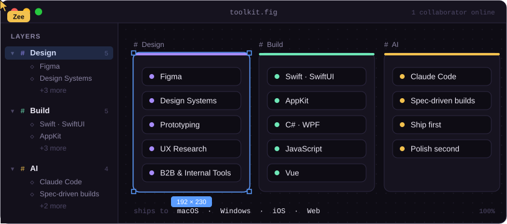

<div align="center">



<br/>

[](https://x.com/madewithzee)
&nbsp;
[](https://github.com/EnigmaticZee)

</div>

---

### Now shipping

<a href="https://github.com/EnigmaticZee/PawsOff"></a>

```
on the bench    a Mac duplicate-tab cleaner  ·  more under Observant Systems
```

---

### How I work



---

### Toolkit



---

<div align="center">

**Designing in daylight, building in public.**<br/>
If something here helped you, a ⭐ goes a long way.

</div>
